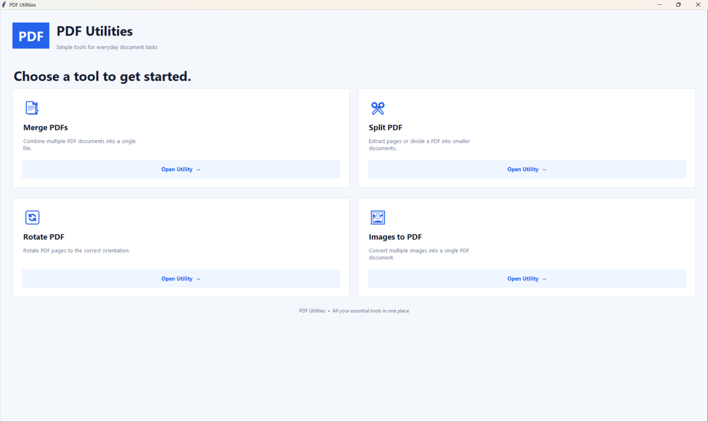
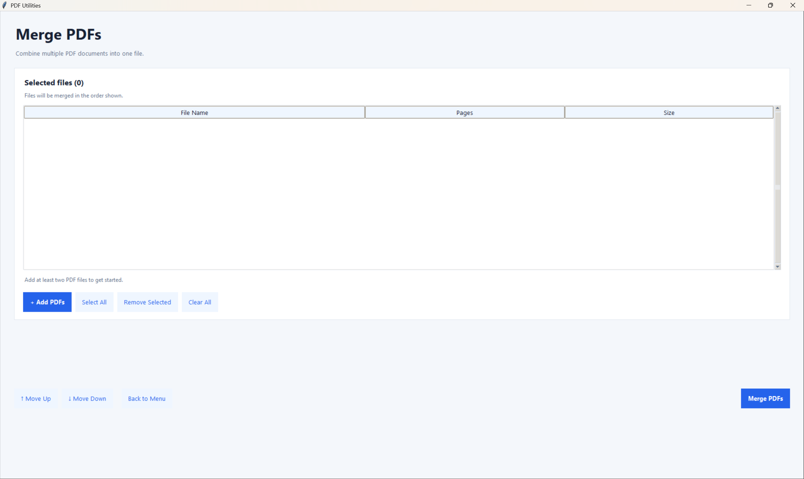
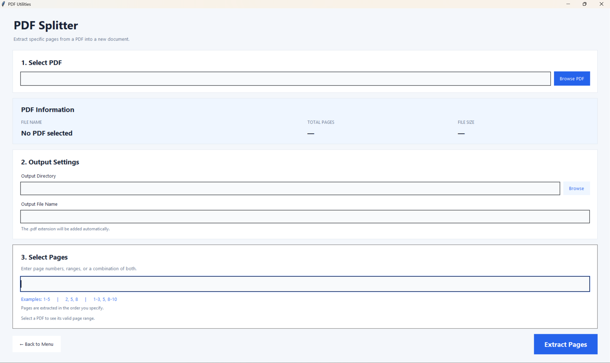
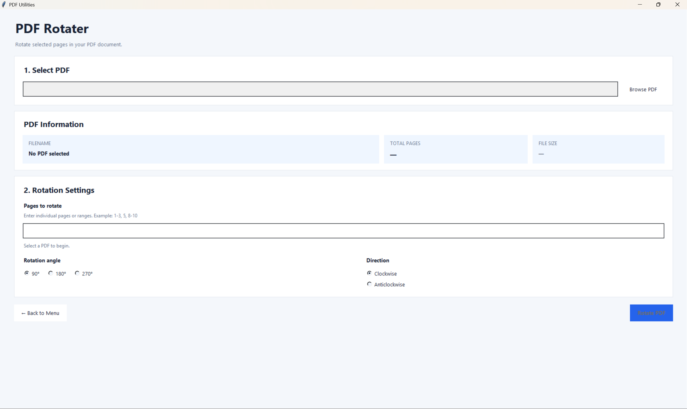
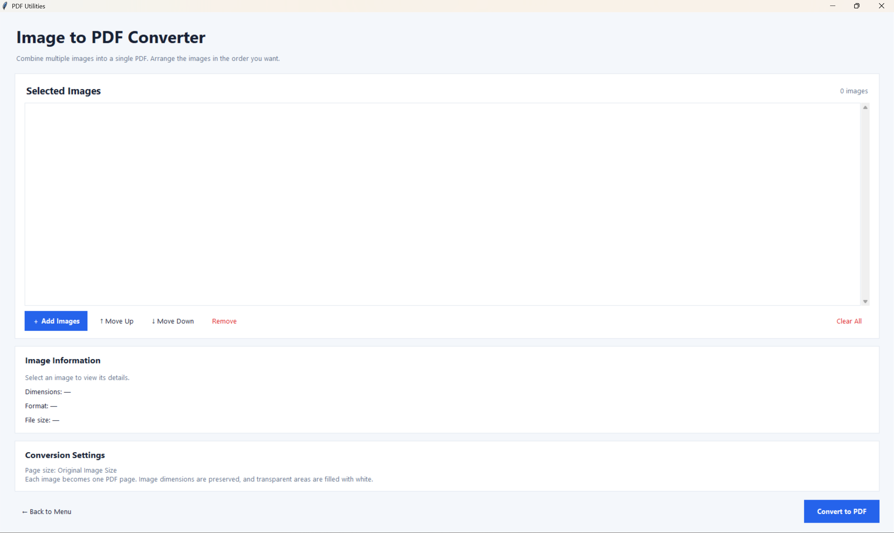

# 📄 PDF Utility Tool

A lightweight, user-friendly **Python desktop application for everyday PDF operations**. PDF Utility Tool provides a simple graphical interface for merging PDF documents, extracting pages, rotating pages, and converting images into PDFs.

Built with Python and Tkinter, the application focuses on simplicity, consistent UI styling, and practical functionality without requiring command-line operations or paid PDF software.

## ✨ Features

### 🔗 1. PDF Merger

Combine multiple PDF documents into a single file.

- Add multiple PDF files.
- Remove files from the selection.
- Reorder documents using **Move Up** and **Move Down**.
- Choose an output location and filename.
- Merge documents in the selected order.

### ✂️ 2. PDF Splitter

Extract specific pages from a PDF document.

- Extract individual pages or page ranges.
- Support multiple page ranges in a single operation.
- Specify ranges such as `1-5`, `8-12`, or `1-3, 7-9`.
- View PDF information, including relevant document and page details.
- Select the output location for extracted pages.

### 🔄 3. PDF Rotater

Rotate individual pages or multiple pages within a PDF document.

- Specify pages individually, such as `1,3,5`.
- Rotate pages by `90°`, `180°`, or `270°`.
- Choose clockwise or anticlockwise rotation.
- Save the modified PDF to your preferred location.

### 🖼️ 4. Image to PDF Converter

Convert multiple images into a single PDF document.

- Supports `.png`, `.jpg`, `.jpeg`, and `.bmp` images.
- Add and remove images before conversion.
- Reorder images to control their sequence in the PDF.
- Choose the output filename and destination.
- Generate a PDF containing the selected images.

## 🖥️ Screenshots

The following sections are placeholders for screenshots of the application. Add your screenshots to the `assets/screenshots/` directory and update the image paths when they are available.

### Main Menu



### PDF Merger



### PDF Splitter



### PDF Rotater



### Image to PDF Converter



## 🛠️ Tech Stack

| Technology | Purpose |
|---|---|
| **Python** | Core programming language |
| **Tkinter** | Desktop graphical user interface |
| **PyPDF2** | PDF reading, merging, page extraction, and rotation |
| **Pillow (PIL)** | Image processing and image-to-PDF conversion |

### UI and Styling

The application uses a shared styling module to maintain a consistent appearance across its different utilities.

- Centralized color palette and typography.
- Reusable buttons, labels, input fields, and card components.
- Consistent styling for tables and scrollbars.
- Shared UI helper functions to reduce duplicated code.

## 📁 Project Structure

```text
Directory structure:
└── PDF-Utility-Tool/
    ├── image_to_pdf.py
    ├── main.py
    ├── pdf_merger.py
    ├── pdf_rotater.py
    ├── pdf_splitter.py
    ├── README.md
    ├── requirements.txt
    ├── screenshots/
    │   ├── image_to_pdf_convertor.png
    │   ├── main_menu.png
    │   ├── pdf_merger.png
    │   ├── pdf_rotater.png
    │   └── pdf_splitter.png
    └── utils.py
```

## ⚙️ Installation and Setup

Follow these steps to run the application locally.

### Prerequisites

Make sure you have:

- Python installed on your system.
- Git installed if you intend to clone the repository.
- `pip`, Python's package installer.

Check your Python and pip installations:

```bash
python --version
python -m pip --version
```

### 1. Clone the Repository

```bash
git clone https://github.com/VRYeshwanth/PDF-Utility-Tool.git
cd PDF-Utility-Tool
```

### 2. Create a Virtual Environment

Creating a virtual environment keeps the project's dependencies separate from other Python projects.

**Windows — Command Prompt or PowerShell**

```bash
python -m venv venv
```

Activate it using Command Prompt:

```bat
venv\Scripts\activate.bat
```

Or activate it using PowerShell:

```powershell
.\venv\Scripts\Activate.ps1
```

**Linux or macOS**

```bash
python3 -m venv venv
source .venv/bin/activate
```

### 3. Install Dependencies

Install the packages listed in `requirements.txt`:

```bash
python -m pip install -r requirements.txt
```

If you encounter dependency errors, check that your Python version is compatible with the packages specified in the requirements file.

**Note:** Tkinter is generally included with standard Python installations on Windows. On some Linux distributions, it may need to be installed separately through the system package manager.

### 4. Run the Application

From the project's root directory, run:

```bash
python main.py
```

The application's main menu should open, allowing you to select the PDF utility you want to use.

## 🚀 How to Use

1. Launch the application using `python main.py`.
2. Select the required utility from the main menu.
3. Add the PDF documents or images you want to process.
4. Configure the relevant options, such as page ranges, rotation settings, or file order.
5. Select the output destination and filename when prompted.
6. Run the operation and check the generated file.

**Tip:** Keep a backup of important documents before performing PDF operations.

## 🧩 Key Design Decisions

- **Modular structure:** Each PDF operation is implemented in its own Python module.
- **Shared styling:** Common UI components and theme definitions are maintained in `utils.py`.
- **Separation of concerns:** The main menu, individual utilities, and shared UI helpers have distinct responsibilities.
- **Reusable components:** Common styling helpers reduce duplication and make future UI changes easier.
- **Local execution:** Files can be processed through the desktop application without requiring a hosted web service.

## 🤝 Contributing

Contributions, bug reports, and feature suggestions are welcome.

To contribute:

1. Fork the repository.
2. Create a feature branch:

   ```bash
   git checkout -b feature/your-feature-name
   ```

3. Make your changes and test the affected functionality.
4. Commit your changes:

   ```bash
   git add .
   git commit -m "Describe your changes"
   ```

5. Push the branch:

   ```bash
   git push origin feature/your-feature-name
   ```

6. Open a pull request describing your changes.

## 📄 License

No license has been specified in this README. If you intend to distribute the project for reuse, consider adding an appropriate open-source license and a corresponding `LICENSE` file.

---